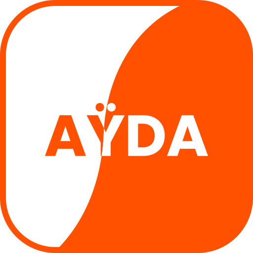
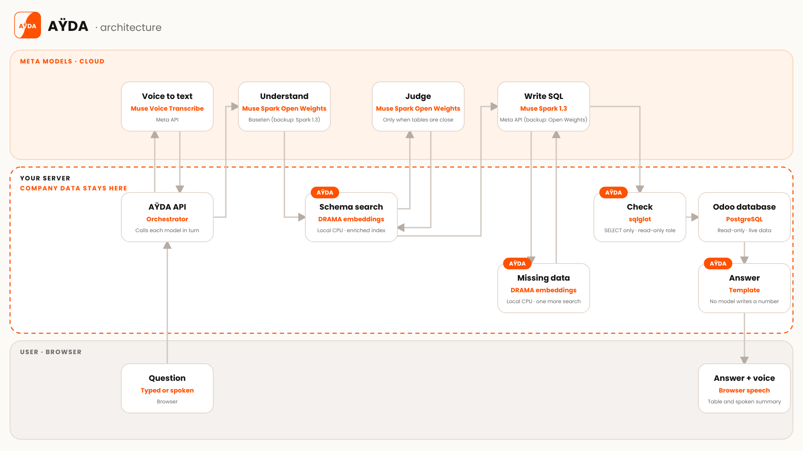

<p align="center"></p>

<h1 align="center">AŸDA · Ask Your DAta</h1>

<p align="center"><b>Ask your company database a question in your own words, typed or spoken, and get the exact answer in seconds. No SQL.</b></p>

<p align="center">Meta Global AI Developer Hackathon 2026 · Built with Meta models · Live on Odoo 18</p>

---

## The problem, and what AŸDA does

In most companies, every report or KPI check goes through a developer or a data analyst: find the data, write the query, format the result. Business users wait, and most questions are never asked.

AŸDA lets a sales, finance or operations manager ask *"What is the least profitable product?"* in English, French or Moroccan Darija. It finds the few tables that matter among hundreds, writes one read-only SQL query, runs it on the live database and answers, with a full trace of how the answer was built.

- **Demo video:** *link to come*
- **Live demo:** available to the judges with a personal access key.

## Meta models

Every model AŸDA calls at run time is a Meta model.

| Role | Model | Where it runs | Backup |
|---|---|---|---|
| Understand the question (rewrite in English, split into subject, measures, filters, grouping, period, order) | Muse Spark Open Weights (`muse-spark-open-1026`) | Baseten | Muse Spark 1.3 |
| Judge, only when two candidate tables are too close | Muse Spark Open Weights | Baseten | Muse Spark 1.3 |
| Write the SQL | Muse Spark 1.3 | Meta API | Muse Spark Open Weights |
| Voice to text | Muse Voice Transcribe | Meta API | none |
| Schema search (embeddings) | DRAMA (`facebook/drama-base`) | locally, on CPU | none |

Answers are read aloud by the browser's built-in voice (not a model: the Meta API has no text-to-speech).

## How it works



1. The browser sends the question (or the audio, turned into text by Muse Voice Transcribe) to the AŸDA API.
2. Muse Spark Open Weights understands the question and splits it into business pieces.
3. DRAMA searches an enriched map of the Odoo schema (business labels, synonyms, notes) and keeps only a handful of tables.
4. Muse Spark 1.3 writes the SQL. If a column is missing, it says what it needs instead of guessing; one more search adds it, and it tries again.
5. The query is checked, then run with a read-only role on the live Odoo database.
6. A template writes the summary from the rows. The browser shows the table and "How this answer was built".

## Guarantees

- **No model ever writes a number.** The database computes, a template writes the summary.
- **The models never see the rows.** They receive the question and a reduced schema only.
- **Read-only.** One `SELECT` only, checked with sqlglot, run with a dedicated read-only PostgreSQL role, with a timeout and a row limit.
- **Honest refusal.** When the data does not exist, AŸDA says what is missing.
- **Transparent.** Every answer shows the understood question, the tables used, the query, and the time and cost of each step.

## Measured results

10 reference questions × 3 runs, compared value by value with hand-written reference SQL (November 2, 2026):

| Correct answers | Average time | Average cost |
|---|---|---|
| **27/30** | ~8 s | under $0.01 per question |

The enrichment was tuned on these questions, so the score is optimistic. Reproduce it with [`benchmark/answer_eval.py`](benchmark/answer_eval.py):

```bash
docker run --rm --network nl2sql_net -v ${PWD}:/w -w /w python:3.11-slim sh -c \
  "pip install -q requests pyyaml psycopg2-binary sqlglot==26.17.1 && \
   python benchmark/answer_eval.py --url http://askyourdata_api:5000 --runs 3"
```

## Quick start (Docker)

Requirements: Docker, a Meta API key and a Baseten API key. No GPU needed.

```bash
# 1. Settings: put your API keys in .env (never in Git)
cp .env.example .env

# 2. Embedding model, Meta's DRAMA (once)
pip install -U "huggingface_hub[cli]"
huggingface-cli download facebook/drama-base --local-dir models/drama-base

# 3. Odoo 18 with demo data, then AŸDA
docker compose -f docker-compose.odoo.yml up -d
#    open http://localhost:8069, create a database with "Load demonstration data",
#    and set SOURCE_DB_NAME=<that database> in .env
docker compose up -d --build

# 4. Read-only role on the Odoo database (set EXEC_DB_PASSWORD in .env first)
docker run --rm --network nl2sql_net -v ${PWD}:/w -w /w python:3.11-slim sh -c \
  "pip install -q psycopg2-binary && python tools/create_readonly_role.py"

# 5. Index the Odoo schema, then import the enrichment files (one per Odoo module)
curl -X POST http://localhost:5000/api/v1/index -H "Content-Type: application/json" -d '{"account_id": 1}'
curl -X POST "http://localhost:5000/api/v1/schema/import?account_id=1" \
  -H "Content-Type: application/json" --data-binary @enrichment/account.json

# 6. Ask
curl -X POST http://localhost:5000/api/v1/ask -H "Content-Type: application/json" \
  -d '{"question": "What is the least profitable product?", "account_id": 1}'
```

The web app is at http://localhost:5000. Production deployment (HTTPS, access keys, quotas): [`documentation/DEPLOY.md`](documentation/DEPLOY.md).

### Key settings (`.env`)

| Variable | Purpose |
|---|---|
| `META_API_KEY`, `BASETEN_API_KEY` | provider keys |
| `PREP_PROVIDER`, `PREP_FALLBACK` | model that understands the question, and its backup |
| `SQL_PROVIDER`, `SQL_FALLBACK` | model that writes the SQL, and its backup |
| `EMBEDDER_MODEL=drama-base`, `EMBEDDER_BACKEND=drama`, `EMBEDDER_TRUST_REMOTE_CODE=true` | DRAMA for the schema search |
| `SOURCE_DB_*`, `EXEC_DB_*` | Odoo database, and the read-only role used to run queries |

All other settings are documented in [`.env.example`](.env.example).

## Repository

```
api_service/      Flask API and web app: pipeline, SQL check, read-only execution, answers, voice
schema_service/   schema index and search (DRAMA + pgvector)
prompts/          prompts for each model role
config/           providers, index filters, synonyms
enrichment/       how to export and import the schema enrichment
benchmark/        reference questions and evaluation scripts
tests/            unit and end-to-end tests
documentation/    architecture, deployment, previous README (French)
```

## Project scope

- **Today:** Odoo 18 Community (demo database); questions in English, French and Darija; answers in English; one question at a time, no memory between questions; read-only.
- **Next:** answers in the language of the question; DRAMA fine-tuned on validated question → table pairs; Odoo custom fields; other ERPs and databases; a sovereign mode with open-weights models only, on the client's own servers.

Full design and decisions: [`documentation/ARCHITECTURE.md`](documentation/ARCHITECTURE.md).

## License

AŸDA's code is released under the [Apache License 2.0](LICENSE). The models are not part of this repository and keep their own licenses (DRAMA: CC-BY-NC 4.0, non-commercial).

## Team

*To complete.*
